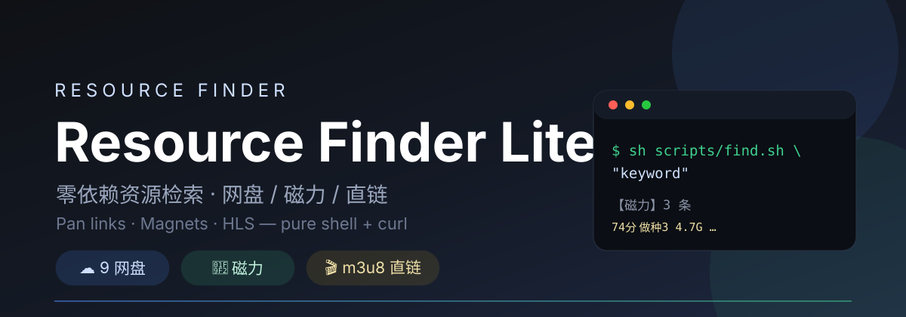

<div align="center">



# 🔍 Resource Finder Lite

**Zero dependencies · No login · No saving to cloud**

Keyword in → pan share links / magnet links / HLS direct links out.

[🇨 简体中文](README.zh-CN.md) · [🏠 Home](README.md)

</div>

## ✨ Features

- 🪶 **Zero dependencies** — just `curl` and a POSIX shell. No Node, no Python, no DB, no alist.
- 🔒 **No account touched** — no transfer, no disk writes, no login state. It only finds links.
- ☁️ **9 pan providers** — Quark, Baidu, Aliyun, UC, China Mobile, Tianyi, 115, PikPak, Xunlei, 123 Pan.
- 🧲 **Magnets with seeder counts** — knaben + apibay queried in parallel, ranked by seeders, size and quality.
- 🎬 **Direct links** — 14 Apple CMS scraper endpoints; outputs `site / title / m3u8 or mp4`.
- 📡 **Douban first-run links** — scan a movie's discussion threads by Douban subject ID.
- 🎞️ **m3u8 to disk** — pull an HLS stream into local `.ts` files; handles multi-bitrate, relative paths and fMP4.
- 🌐 **One-file web page** — open it and go, bilingual UI with a `中文 / EN` switch.
- 🧮 **Editable rules** — one regex per line in `scripts/rules.tsv`, effective immediately.

## 🚀 Quick start

```bash
git clone https://github.com/strange2000/resource-search-lite.git
cd resource-search-lite

# pan + magnets (main entry)
bash scripts/find.sh "keyword"

# magnets only, fastest (~6–15s)
bash scripts/find.sh "keyword" --磁力 --条数 10

# selected providers only
bash scripts/find.sh "keyword" --类型 quark,baidu

# one link per line, pipe friendly
bash scripts/find.sh "keyword" --只链接

# machine readable
bash scripts/find.sh "keyword" --json

# all three lanes at once: pan + magnets + HLS
bash scripts/all.sh "keyword"

# HLS links only
bash scripts/collect.sh "keyword"

# Douban discussion threads (argument is a subject ID)
bash scripts/社群首发.sh 37817151

# pull an m3u8 into local .ts (grab 6 segments first)
bash scripts/m3u8取流.sh "https://…/index.m3u8" --名 title --片 6

# connectivity self-test
bash scripts/find.sh --测
```

The CLI flags are intentionally Chinese (`--磁力`, `--只链接` …) because they are part of the original interface; see the table below for meanings.

| Flag | Meaning |
|---|---|
| `--磁力` | magnets only, skip pan search |
| `--只链接` | print URLs only, one per line |
| `--json` | machine-readable output |
| `--类型 quark,baidu` | restrict to given pan providers |
| `--条数 N` | max magnet rows (default 20) |
| `--网盘条数 N` | max rows per pan provider (default 10) |
| `--测` | self-test all sources |

On Android, BusyBox or a router, use `sh` instead of `bash`.

## ⚙️ Configure the search instance

Pan search uses a public [PanSou](https://github.com/fish2018/pansou) instance. **Public instances get rate-limited** — 403, Cloudflare 400 and 60-second stalls are all normal. Use your own:

```bash
# env var; comma-separate several instances, it falls back automatically
RS_INSTANCE=https://your-pansou.example.com bash scripts/find.sh "keyword"
RS_INSTANCE=https://a.example.com,https://b.example.com bash scripts/find.sh "keyword"
```

Priority: `RS_INSTANCE` → built-in default. `config.json` is a centralized description of the same settings; the shell scripts actually read the env var and `scripts/rules.tsv`.

## 🌐 Web page

`web/index.html` is a single static file — no build step, no backend:

- Open it directly, or host it anywhere (GitHub Pages, Cloudflare Pages, Nginx)
- Instance: `index.html?instance=https://your-pansou.example.com`, comma-separate for several
- Language: `中文 / EN` in the top-right corner, or `?lang=zh` / `?lang=en`; the choice is remembered
- Light / dark theme, search history, provider filters, inline HLS player, retry

Magnets work in the browser because they come from the same instance's `magnet` channel (CORS enabled). The trade-off: **title + magnet only, no seeders or size**. For the full ranked list, use the CLI.

## 🎬 Scraper endpoints (Apple CMS)

`scripts/collect.sh` queries 14 Apple CMS endpoints backed by thousands of Chinese media sites:

```bash
bash scripts/collect.sh "title"          # strict: title must contain the keyword
bash scripts/collect.sh "title" --宽      # no relevance filter, just see what's there
bash scripts/collect.sh "title" --满      # up to 20 rows per site (default 8)
bash scripts/collect.sh --探活            # which endpoints are alive today
bash scripts/collect.sh "title" --超时=8  # per-endpoint timeout in seconds (default 15)
```

Output is TSV: `site <TAB> title <TAB> direct link`.

These APIs never send `Access-Control-Allow-Origin`, so they **only work from a terminal** — the web page deliberately omits them.

Known quirks:

- Android Chrome cannot play m3u8 directly; hand the URL to VLC / nPlayer / MX Player, or convert with ffmpeg.
- Some sites escape Chinese as `\uXXXX`; the title looks garbled but the link works.
- Endpoint domains change often. No code change needed — append the new one to the `EP` list at the top of the script.
- Measured on 2026-11-14: `--探活` → 7 alive / 7 dead; “三体” → 27 rows from 6 sites in 13 s.

## 📡 Douban discussion threads

New or obscure titles are often missing from every pan index and magnet tracker, yet the first-run link is sitting in a Douban discussion thread (that is how 《钥匙 / 鍵 2026》 was found). `社群首发.sh` uses Douban's public rexxar API — no login:

```bash
bash scripts/社群首发.sh 37817151                    # scan every thread of the subject
bash scripts/社群首发.sh 37817151 --topic 498744331  # scan one thread only
bash scripts/社群首发.sh 37817151 --max 200          # up to 200 replies per thread (default 100)
bash scripts/社群首发.sh 37817151 --no-expand        # do not expand short links
```

Output TSV: `thread-id <TAB> type <TAB> link`, where type is Quark / Baidu / 115 / magnet / short / direct.

The argument is a **Douban subject ID**, not a title. Many replies are paid funnels ("DM me", "how much"), so only `s/xxxxxxx`-shaped links are real. The script also handles look-alike evasions such as "left slash"; always verify a link yourself.

## 🎞️ m3u8 to local .ts

```bash
bash scripts/m3u8取流.sh "https://…/index.m3u8" --名 title
bash scripts/m3u8取流.sh "https://…/index.m3u8" --片 6          # first 6 segments, quick check
bash scripts/m3u8取流.sh "https://…/index.m3u8" --并发 4 --目录 ./out
bash scripts/m3u8取流.sh ./local.m3u8 --名 test                # local playlists work too
```

It handles master playlists (picks the highest `BANDWIDTH`), relative URLs, `EXT-X-MAP` init segments (fMP4) and retries each segment up to 3 times. It **refuses** `METHOD=AES-128` (no openssl on the phone) and exits with code 3.

Output is `.ts`, not mp4. To remux on a computer: `ffmpeg -i x.ts -c copy -bsf:a aac_adtstoasc x.mp4`. A full movie can be thousands of segments and hundreds of MB — avoid doing it on mobile data.

## 🧮 Scoring

`scripts/rules.tsv` is `regex<TAB>points<TAB>label` per line, matched with `grep -E`, case-insensitive:

```
2160p|4K|UHD	25	4K
1080p|FHD|全高清	20	1080p
中字|中文字幕|简中|繁中	18	subs
枪版|CAM|抢先版	-50	cam
```

Additional rules:

- Seeders: +1 per 2 seeders, capped at +20
- Recency: ≤1 day +20 / ≤7 days +12 / ≤30 days +5 / >1 year −10
- Size < 150 MB: −15
- Any excluded word (trailer, cam, expired …) skips the row entirely

## 📁 Layout

```
resource-search-lite/
├── SKILL.md               Agent / CLI instructions (with frontmatter)
├── config.json            Central description of instances, sources and scoring
├── scripts/
│   ├── find.sh            Pan + magnets (main entry)
│   ├── collect.sh         Apple CMS direct links (terminal only)
│   ├── all.sh             All three lanes at once
│   ├── 社群首发.sh         Douban threads (argument is a subject ID)
│   ├── m3u8取流.sh        m3u8 → local .ts
│   └── rules.tsv          Scoring rules
└── web/
    ├── index.html         Single-file web page (bilingual)
    └── assets/banner.svg  Cover image
```

## 🛡️ Privacy

- No accounts, cookies or tokens; it does not read data from other sites in your browser
- No telemetry, nothing uploaded
- The web page keeps provider filters, language and search history in your own `localStorage` only
- The CLI writes nothing to disk; temp files are removed on exit

## ⚠️ Limitations

- Public instances are flaky: wait 30–60 s or use your own instance
- mksh arithmetic is 32-bit; sizes above 2 GB are approximated, roughly ±0.1 G
- International magnet indexes ignore CJK text — try the Chinese title first
- Pan search only: no transfer, no saving, no account access

## ⚖️ Disclaimer

This project only **aggregates and ranks public indexes**. It does not host, store or distribute any file, does not provide downloads, and does not bypass any paywall or login. All links come from third-party public APIs; availability and legality are the responsibility of those sources. Check your local laws and platform terms. Rights holders may open an issue to have an endpoint removed.

## 📄 License

[MIT](LICENSE)
