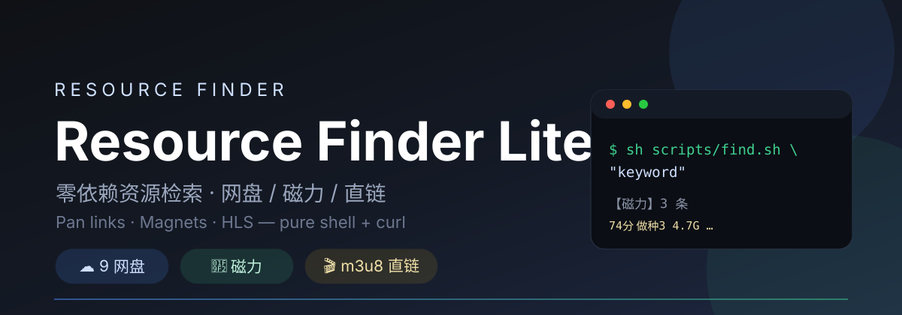

<div align="center">



# 🔍 Resource Finder Lite · 资源搜索 Lite

**Zero-dependency resource search · 零依赖资源检索**

[🇨🇳 简体中文](README.zh-CN.md) · [🇬🇧 English](README.en.md)

[](LICENSE)
[](#)
[](#)
[](web/index.html)

Keyword in → **pan share links · magnet links · HLS direct links** out.
关键词进 → **网盘分享链接 · 磁力链 · m3u8 直链** 出。

</div>

## 🧩 这个仓库有两件东西 · Two independent parts

| | 🛠️ Command-line skill | 🌐 Single-file web page |
|---|---|---|
| 路径 / Path | `scripts/` + `SKILL.md` | `web/index.html` |
| 依赖 / Needs | `curl` + a POSIX shell | any browser |
| 能做 / Does | 网盘 + 磁力 + 苹果CMS 直链，按做种数 / 体积 / 清晰度排序 | 网盘 + 磁力（受 CORS 限制，无做种数） |
| 适合 / Best for | 手机终端、Agent、批处理 | 双击打开、静态托管、手机浏览器 |

两边**互不依赖**：只要网页就下载 `web/index.html` 一个文件；只要命令行就拷走 `scripts/`。
The two parts are independent: the web page is one file, the CLI is one folder.

## ⚡ 30 秒上手 · Quick start

```bash
git clone https://github.com/strange2000/resource-search-lite.git
cd resource-search-lite

bash scripts/find.sh "keyword"        # 网盘 + 磁力 / pan + magnets
bash scripts/collect.sh "keyword"     # m3u8 / mp4 直链 / HLS links
```

Android、BusyBox、路由器上用 `sh` 代替 `bash`。
On Android, BusyBox or a router, use `sh` instead of `bash`.

## 🌐 网页版 · Web page

打开 `web/index.html` 即可，无需构建、无需后端。右上角 `中文 / EN` 一键切换。
Just open `web/index.html` — no build, no backend. Toggle `中文 / EN` in the top-right corner.

- 指定实例 / custom instance: `index.html?instance=https://your-pansou.example.com`
- 多实例 / multiple: `?instance=https://a,https://b`
- 中英双语 / bilingual UI, follows browser language by default

## 📚 详细文档 · Full docs

- [🇨🇳 中文完整说明](README.zh-CN.md)
- [🇬🇧 Full documentation in English](README.en.md)

## ⚖️ 免责声明 · Disclaimer

只聚合公开索引，不托管、不存储、不分发任何文件，不提供下载服务。
Aggregates public indexes only; hosts, stores and distributes nothing.

## 📄 License

[MIT](LICENSE)
